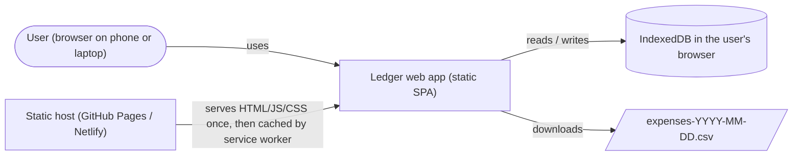
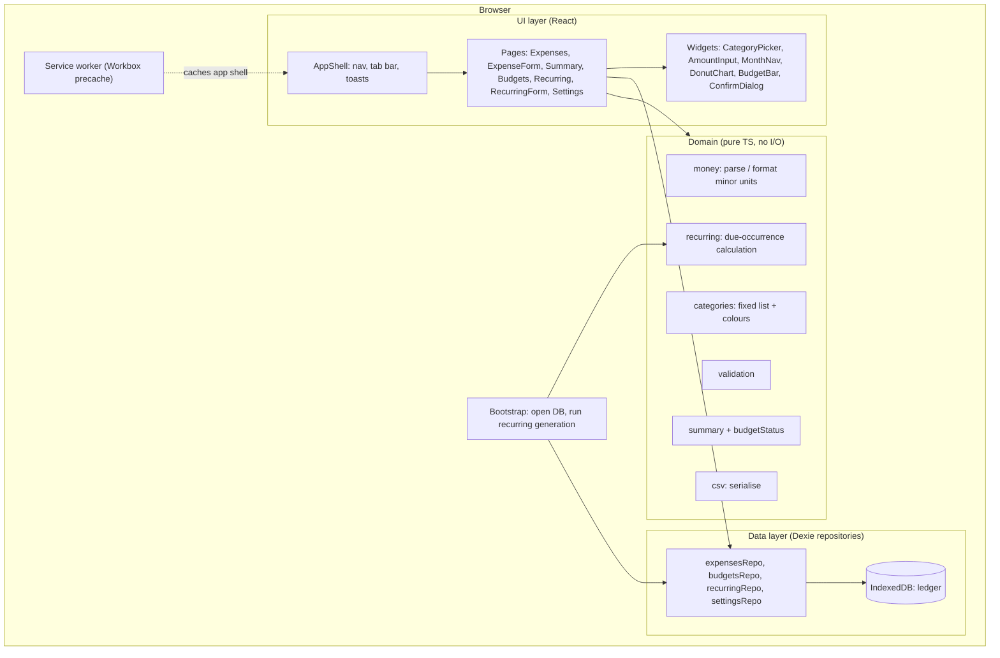
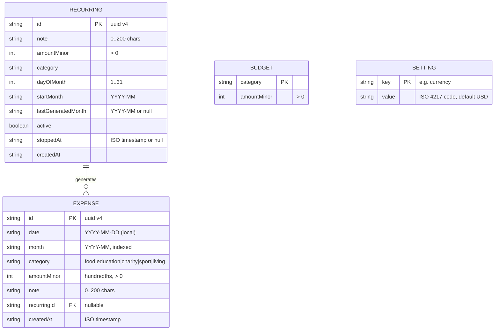
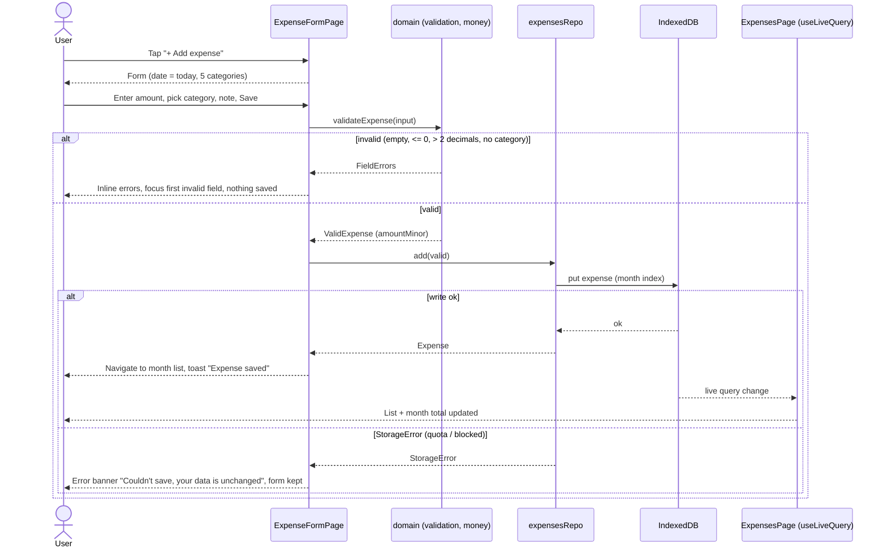
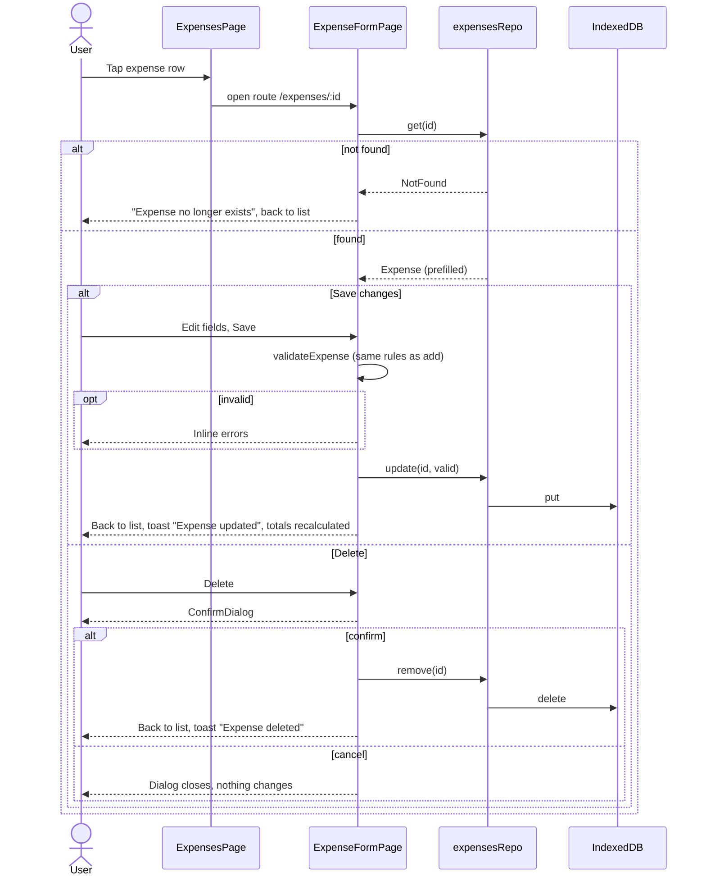
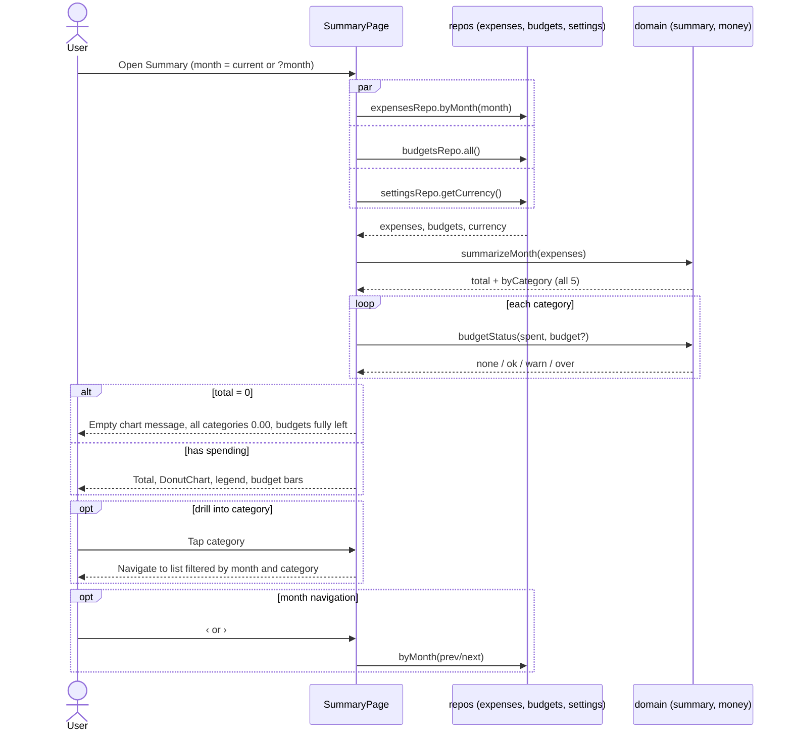
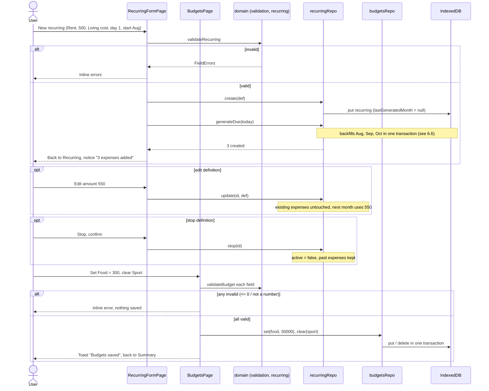
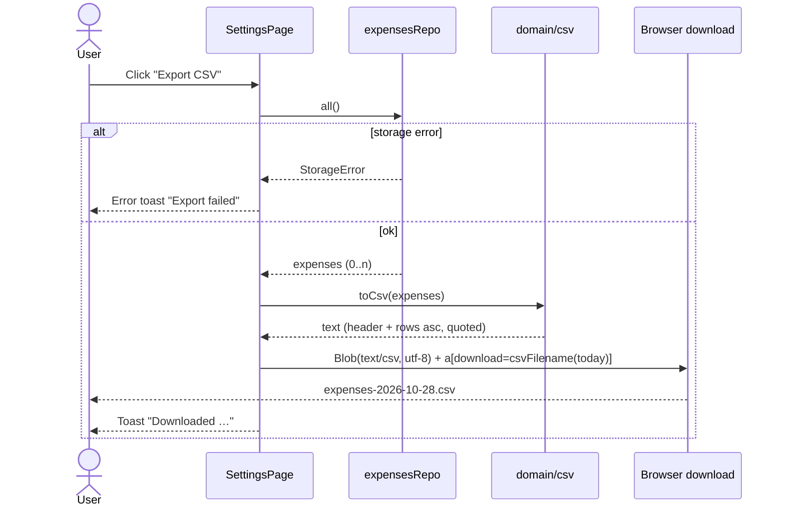
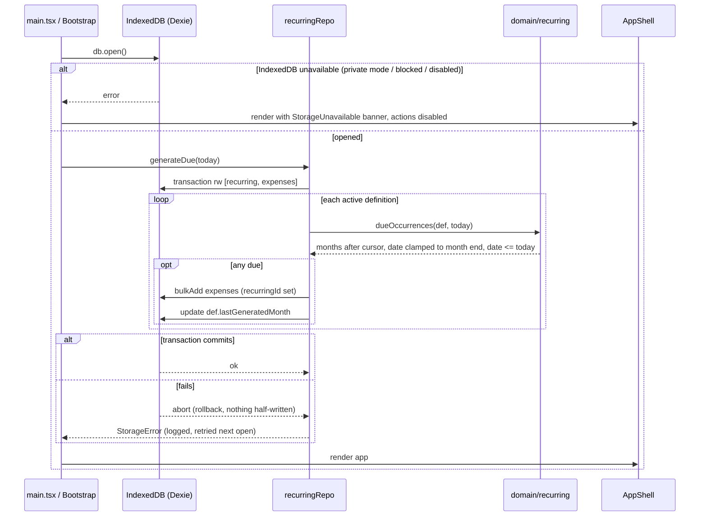
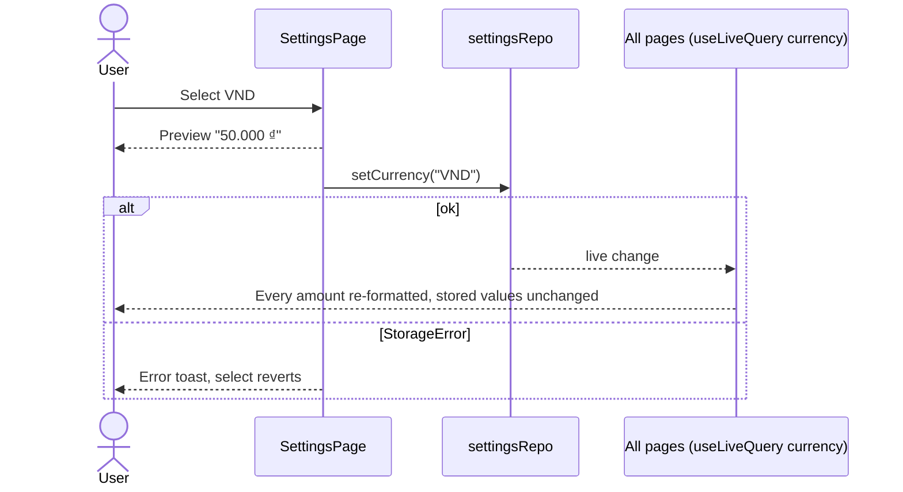

# Solution Design: Ledger (Expense Tracker)

| | |
|---|---|
| Status | Draft |
| PRD | docs/01-prd.md |
| Mockups | docs/02-mockups/index.html |
| Last updated | 2026-10-28 |

## 1. Overview & key decisions
A single-page web app that runs entirely in the browser. There is no backend: all data lives in the browser's IndexedDB on the user's device. The business rules (money, totals, budgets, recurring generation, CSV) are pure TypeScript functions so they are easy to unit-test. A thin data layer persists records, and React renders the screens from the mockups.

| Concern | Choice | Why |
|---|---|---|
| Language | TypeScript (strict) | Type safety for money and dates; one language everywhere |
| Frontend | React 18 + Vite | Boring, well documented, fast dev server and static build |
| Routing | React Router (hash router) | Works on any static host and from `file://` previews with no server rewrites |
| Backend | **None** | PRD needs a single user, no account and no network (REQ-014, REQ-016) |
| Storage | IndexedDB via **Dexie 4** (+ `dexie-react-hooks` `useLiveQuery`) | Durable, indexed, async, holds 5,000+ rows easily; live queries re-render on change |
| Chart | Hand-written SVG donut | One small chart; no charting dependency |
| Styling | Plain CSS with the design tokens from `docs/02-mockups/styles.css` | Mockups already define the system; no CSS framework needed |
| Offline | `vite-plugin-pwa` (Workbox precache) | App shell cached after first load (REQ-016) |
| Testing | Vitest + Testing Library + `fake-indexeddb`; Playwright + `@axe-core/playwright` | Unit and component tests in Node, and real-browser e2e and a11y checks |
| Hosting | Static files: GitHub Pages / Netlify / Cloudflare Pages free tier, or local `npm run preview` | Zero cost, no server |

## 2. System context

No external services receive user data. The static host serves only code.

## 3. Components


| Component | Responsibility | REQs |
|---|---|---|
| AppShell | Layout, top nav (≥ 768 px) / tab bar (< 768 px), FAB, toast host, storage-error banner | REQ-017, REQ-018 |
| ExpensesPage | Month list (newest first), month nav, category filter, empty state, at-a-glance budgets (≥ 1024 px) | REQ-005, REQ-009, REQ-010 (badge), REQ-017 |
| ExpenseFormPage | Add / edit / delete expense with validation and confirm dialog | REQ-001, REQ-003, REQ-004 |
| SummaryPage | Month total, per-category totals, donut chart, budget status | REQ-006, REQ-007, REQ-009 |
| BudgetsPage | Set / change / clear per-category budget | REQ-008 |
| RecurringPage / RecurringFormPage | List, create, edit, stop recurring definitions | REQ-010, REQ-011 |
| SettingsPage | Currency select with preview, CSV export, data notice | REQ-012, REQ-013, REQ-014, REQ-016 |
| Widgets | CategoryPicker (radio group), CategoryBadge, AmountInput, MonthNav, DonutChart, BudgetBar, ConfirmDialog (`<dialog>`) | REQ-002, REQ-007, REQ-009, REQ-018 |
| Bootstrap | Opens DB, detects unavailable storage, runs recurring generation before first render | REQ-010, REQ-014 |
| domain/money | String ↔ integer minor units, currency formatting via `Intl.NumberFormat` | REQ-001, REQ-013, REQ-019 |
| domain/categories | The five categories, order, colour token, icon, label | REQ-002 |
| domain/validation | Expense, budget and recurring input rules | REQ-001, REQ-003, REQ-008, REQ-010 |
| domain/summary | Per-category totals and budget status for a month | REQ-006, REQ-009, REQ-019 |
| domain/recurring | Which occurrence dates are due for a definition (last-day fallback) | REQ-010, REQ-011 |
| domain/csv | RFC 4180 serialisation, filename | REQ-012 |
| Data repositories | CRUD + month queries on Dexie tables; atomic generation transaction | REQ-003, REQ-004, REQ-005, REQ-008, REQ-010, REQ-011, REQ-014, REQ-015 |
| Service worker | Precache build output for offline use | REQ-016 |

## 4. Data model


**Field notes**
- **Dexie schema v1**: `expenses: 'id, month, date, category, recurringId'`, `budgets: 'category'`, `recurring: 'id, active'`, `settings: 'key'`. Future changes go through Dexie `version(n).upgrade()`.
- **Money (REQ-019)**: `amountMinor` is always hundredths of the currency unit, whatever the currency (see ADR-002). For example, 12.50 is stored as `1250` and 50,000 VND as `5000000`. Totals are integer sums, so there is no float drift.
- **`month`** is stored with the expense so a month view is one indexed query (REQ-015).
- **Budget absence**: no row means "No budget". Clearing a budget deletes the row.
- **Recurring cursor**: `lastGeneratedMonth` is the latest month whose occurrence has been created. Generation only moves forward, so a generated expense that the user deletes is never recreated (REQ-010 AC4), and editing a definition affects only months after the cursor (REQ-011).
- **Dates** are local calendar dates as strings, which avoids time-zone shifts from `Date` objects in storage.

## 5. Interfaces / API contracts
There is no HTTP API. The contracts are the TypeScript signatures of the domain and data layers. Repositories return Promises and throw `StorageError` when IndexedDB fails. Validation returns typed results and never throws.

### Domain
```ts
type CategoryId = 'food' | 'education' | 'charity' | 'sport' | 'living';
const CATEGORIES: readonly { id: CategoryId; label: string; icon: string; colorVar: string }[]; // fixed order (REQ-002)

// money.ts (REQ-001, REQ-013, REQ-019)
parseAmount(input: string): { ok: true; minor: number } | { ok: false; error: 'required' | 'not_number' | 'not_positive' | 'too_many_decimals' };
formatAmount(minor: number, currency: string, locale?: string): string; // "$12.50", "50.000 ₫"

// validation.ts
validateExpense(input: ExpenseInput): Result<ValidExpense, FieldErrors>;      // amount, category, date, note ≤ 200
validateBudget(input: string): Result<number /*minor*/, 'not_number' | 'not_positive'>;
validateRecurring(input: RecurringInput): Result<ValidRecurring, FieldErrors>; // + dayOfMonth 1..31, startMonth

// summary.ts (REQ-006, REQ-009)
summarizeMonth(expenses: Expense[]): { totalMinor: number; byCategory: Record<CategoryId, number> }; // all 5 keys present
budgetStatus(spentMinor: number, budgetMinor?: number):
  | { kind: 'none' }
  | { kind: 'ok' | 'warn' | 'over'; percent: number; remainingMinor: number }; // warn ≥ 80, over > 100

// recurring.ts (REQ-010, REQ-011)
dueOccurrences(def: Recurring, today: LocalDate): { month: string; date: string }[];
// months after max(lastGeneratedMonth, startMonth - 1) up to today's month, whose occurrence date ≤ today;
// day clamped to month length; [] when !active

// csv.ts (REQ-012)
toCsv(expenses: Expense[]): string;             // header + rows sorted by date asc, RFC 4180 quoting, UTF-8 BOM
csvFilename(today: LocalDate): string;           // "expenses-2026-10-28.csv"
```

### Data repositories
| Function | Behaviour | Errors |
|---|---|---|
| `expensesRepo.add(v: ValidExpense): Promise<Expense>` | Assigns `id`, `month`, `createdAt` | `StorageError` |
| `expensesRepo.update(id, v: ValidExpense)` | Recomputes `month` | `NotFound`, `StorageError` |
| `expensesRepo.remove(id)` | Hard delete | `NotFound`, `StorageError` |
| `expensesRepo.byMonth(month: string): Promise<Expense[]>` | Indexed by `month`, sorted date desc then `createdAt` desc | `StorageError` |
| `expensesRepo.all(): Promise<Expense[]>` | For export | `StorageError` |
| `budgetsRepo.all() / set(cat, minor) / clear(cat)` | `clear` deletes the row | `StorageError` |
| `recurringRepo.list() / create(v) / update(id, v) / stop(id)` | `update` doesn't touch existing expenses; `stop` sets `active=false` | `NotFound`, `StorageError` |
| `recurringRepo.generateDue(today): Promise<number>` | One `rw` transaction over `recurring` + `expenses`: for each active definition, insert `dueOccurrences` and advance `lastGeneratedMonth`; returns count inserted | `StorageError` (transaction rolls back, so nothing is half-written) |
| `settingsRepo.getCurrency() / setCurrency(code)` | Default `USD` | `StorageError` |

### Routes (hash)
`#/` expenses (`?month=YYYY-MM&cat=…`) · `#/expenses/new` · `#/expenses/:id` · `#/summary?month=` · `#/budgets` · `#/recurring` · `#/recurring/new` · `#/recurring/:id` · `#/settings`

## 6. Sequence diagrams
### 6.1 Journey: Record a daily expense (REQ-001, REQ-002, REQ-005, REQ-013, REQ-019)


### 6.2 Edit or delete an expense (REQ-003, REQ-004)


### 6.3 Journey: Review the month (REQ-005, REQ-006, REQ-007, REQ-009)


### 6.4 Journey: Set up fixed costs and limits (REQ-008, REQ-010, REQ-011)


### 6.5 Journey: Take data out (REQ-012)


### 6.6 Background: recurring generation on app open (REQ-010, REQ-011, REQ-014)

Because the cursor and the inserts commit together, running twice (two tabs or a reload) cannot create duplicates. A second tab sees the advanced cursor once the first transaction commits; Dexie serialises `rw` transactions on the same tables.

### 6.7 Currency change (REQ-013)


## 7. Detailed design
### Project layout
```
index.html
vite.config.ts            # react, vite-plugin-pwa
src/
  main.tsx                # bootstrap (6.6), router
  App.tsx                 # AppShell + routes
  domain/   categories.ts money.ts dates.ts validation.ts summary.ts recurring.ts csv.ts  (+ *.test.ts)
  data/     db.ts expensesRepo.ts budgetsRepo.ts recurringRepo.ts settingsRepo.ts errors.ts (+ *.test.ts with fake-indexeddb)
  ui/
    components/ AppShell.tsx CategoryBadge.tsx CategoryPicker.tsx AmountInput.tsx MonthNav.tsx
                DonutChart.tsx BudgetBar.tsx ConfirmDialog.tsx Toast.tsx EmptyState.tsx
    pages/      ExpensesPage.tsx ExpenseFormPage.tsx SummaryPage.tsx BudgetsPage.tsx
                RecurringPage.tsx RecurringFormPage.tsx SettingsPage.tsx
    hooks/      useCurrency.ts useMonthParam.ts useToast.ts
  styles/   tokens.css base.css   # ported from docs/02-mockups/styles.css
e2e/        *.spec.ts  fixtures/seed.ts
```

### domain/money
- `parseAmount` trims, accepts `.` as the decimal separator (and `,` when it is the only separator), and matches `^\d+(\.\d{1,2})?$`. It converts with string math (`int * 100 + frac`), never `parseFloat * 100`.
- `formatAmount(minor, currency)` uses `Intl.NumberFormat(locale, { style: 'currency', currency })`. The value is `minor / 100`, rounded to the currency's `maximumFractionDigits`, so VND shows no decimals. Formatter instances are cached per currency.

### domain/recurring
- `clampDay(year, month, day) = min(day, daysInMonth)`.
- The start is `lastGeneratedMonth ? next(lastGeneratedMonth) : startMonth`. Iterate month by month up to today's month. Include a month only if `clampDay(...) <= today`. If today's occurrence isn't due yet, the cursor stays on the previous month, so it is picked up on a later open.
- Editing (`update`) changes amount, category, note and day, but not `startMonth` or the cursor. Past expenses are separate rows and stay unchanged (REQ-011).

### domain/summary
- `summarizeMonth` initialises all five categories to 0 and sums `amountMinor`. The total is the sum of the category totals, which guarantees REQ-019 AC2.
- `budgetStatus`: `percent = floor(spent * 100 / budget)`; `over` if spent > budget, `warn` if percent ≥ 80, otherwise `ok`. The bar width is capped at 100%.

### domain/csv
- Header `date,category,amount,note,recurring`. The category is the label (e.g. "Living cost"), the amount is `minor/100` with 2 decimals and no currency symbol, and `recurring` is `true` or `false`.
- A field is quoted if it contains `,` `"` `\r` or `\n`, with inner quotes doubled. Lines end in CRLF and the file starts with a UTF-8 BOM so Excel detects the encoding.

### UI pages
- Data reads use `useLiveQuery` so lists and totals refresh after any write, with no manual cache.
- Month state lives in the URL (`?month=YYYY-MM`, `?cat=`), so back/forward and the deep links from Summary work.
- Forms are controlled components. Validation runs on submit and again on blur after the first submit. Errors are linked with `aria-describedby`, and focus moves to the first invalid field.
- ExpensesPage groups rows by date. On an empty month it shows `EmptyState`; when a filter matches nothing it shows a "No expenses in this category" line.
- The at-a-glance budget panel on ExpensesPage is rendered only via CSS at ≥ 1024 px, reusing `BudgetBar`.
- `ConfirmDialog` uses the native `<dialog>` with `showModal()`, which handles focus trapping and Esc.
- Toasts use `role="status"`.

### Error handling
- `StorageError` is shown as a non-blocking banner (writes) or a full-page notice (DB unavailable at boot). User input is never discarded on a failed save.
- If `navigator.storage.persist()` is available it is requested once at boot, to reduce the risk of eviction (REQ-014).

## 8. Non-functional design
| REQ | How it is met | How it is verified |
|---|---|---|
| REQ-015 Performance | `month` index → one indexed query per view; aggregation O(n) over the month only; no charting library; app JS budget < 150 KB gzip | Playwright: seed 5,000 expenses, `performance.now()` from navigation to list + summary visible < 1000 ms; save → updated row < 200 ms |
| REQ-016 Privacy & offline | No backend, no analytics, no external fonts/CDNs; Workbox precaches the build; CSP `default-src 'self'` in `index.html` meta | Playwright: record `page.on('request')` during add/edit/view/export, assert only same-origin static asset requests; `context.setOffline(true)` then full journey passes |
| REQ-017 Responsive | Mobile-first CSS from mockups; breakpoints 768 px (top nav) and 1024 px (two columns) | Playwright at 360×740 asserts `scrollWidth <= clientWidth` on each route; at 1280 px asserts the two columns sit side by side |
| REQ-018 Accessibility | Semantic HTML, labelled inputs, radio-group category picker, visible `:focus-visible`, text status beside colour, AA-checked tokens | `@axe-core/playwright` on every route: 0 serious/critical; keyboard-only e2e for add expense |
| REQ-019 Money accuracy | Integer hundredths; string-based parsing; totals = integer sums | Unit tests: `0.10 + 0.20 → "0.30"`, total equals sum of rows (property-style test over random data) |
| REQ-014 Persistence | IndexedDB + `storage.persist()` request | e2e: add data, reload / new page in the same context, data present |

## 9. Testing strategy
| Layer | Tool | Covers | Command |
|---|---|---|---|
| Unit | Vitest | domain/*: parsing, formatting (USD/VND/EUR), validation rules, summary + budget thresholds (40/83/110%), recurring due dates (backfill, day 31 → Feb 28/29, no dup after cursor, stopped), CSV quoting/BOM/sort | `npm test` |
| Integration | Vitest + `fake-indexeddb` | repositories: CRUD, byMonth ordering, generateDue transaction (idempotent, rollback on failure, deleted generated not recreated, edit affects future only) | `npm test` |
| Component | Vitest + Testing Library (jsdom) | forms show inline errors and block save; ConfirmDialog cancel/confirm; Summary renders all 5 categories and the empty state | `npm test` |
| E2E | Playwright (Chromium + WebKit mobile viewport) | the four PRD journeys end-to-end, with `page.clock` fixed to 2026-10-28 for recurring; CSV download content; currency switch; persistence across reload | `npm run test:e2e` |
| A11y / NFR | `@axe-core/playwright`, Playwright perf + offline + network specs | REQ-015 – REQ-018 | `npm run test:e2e` |
| Static | `tsc --noEmit`, ESLint | types, hooks rules | `npm run typecheck && npm run lint` |
| Build | Vite | production bundle + SW | `npm run build` |

`npm run verify` runs typecheck, lint, unit/integration and e2e in sequence. This is the command the Flow verifier uses.

## 10. Risks & ADRs
| Risk | Impact | Mitigation |
|---|---|---|
| Browser clears site data (storage eviction, user clears history, Safari 7-day ITP for non-installed sites) | Total data loss | Request `storage.persist()`; Settings explains it and promotes CSV export; suggest "Add to Home Screen" (installed PWAs are exempt from Safari's 7-day rule) |
| Recurring generation produces duplicates or misses months (multi-tab, time zones, month-end days) | Wrong totals, user distrust | Cursor + single `rw` transaction; local-date strings only; exhaustive unit tests for month-end and backfill |
| Floating-point money errors | Totals off by a cent | Integer minor units and string parsing (ADR-002) |
| IndexedDB unavailable (some private modes) | App unusable | Detect at boot, show a clear notice instead of failing silently |
| Fixed 2-decimal storage with 0-decimal currencies (VND, JPY) | 12.50 VND displays as "13 ₫" | Accepted for v1. Input of decimals is still allowed per PRD, and display rounds. Revisit if multi-currency is added |
| Scope creep (import, sync) | Delays v1 | Out of scope per PRD §7 |

### ADR-001: No backend; IndexedDB via Dexie
**Context**: single user, no account, privacy and offline requirements. **Options**: (a) localStorage, (b) IndexedDB via Dexie, (c) small server + SQLite, (d) hosted BaaS (Supabase/Firebase). **Decision**: (b). **Consequences**: no hosting cost and no data leaves the device. Indexed month queries and atomic transactions are needed for recurring generation, which localStorage lacks. Sync across devices is impossible without a future backend; CSV export is the backup.

### ADR-002: Store money as integer hundredths regardless of currency
**Context**: REQ-019 needs exact arithmetic, and REQ-013 says changing the currency must not change stored values. **Options**: (a) floats, (b) minor units per currency's decimals, (c) fixed hundredths. **Decision**: (c). **Consequences**: exact sums, and a currency switch is display-only. With 0-decimal currencies the last two digits are always 00 unless the user types decimals, which are then rounded for display (see risks).

### ADR-003: Recurring generation on open with a per-definition cursor
**Context**: no background execution in a static web app; REQ-010 needs backfill without duplicates and without recreating deleted items. **Options**: (a) check whether a matching expense exists for each month, (b) store `lastGeneratedMonth` per definition. **Decision**: (b). **Consequences**: deletions are respected and generation is idempotent and cheap. A definition only ever moves forward, so "regenerate past months" would need an explicit future feature.

### ADR-004: React + Vite SPA with hash routing
**Context**: 7 screens, forms, live data. **Options**: vanilla TS, React, Svelte. **Decision**: React + Vite, the most widely known with good testing tools. Hash routing removes the need for host rewrites. **Consequences**: about 45 KB gzip runtime, well within the performance budget.

## 11. Traceability
| REQ | Components | Sequence | Tests |
|---|---|---|---|
| REQ-001 Add expense | ExpenseFormPage, AmountInput, CategoryPicker, domain/validation, domain/money, expensesRepo | 6.1 | Unit (validation, parseAmount), Component (form errors), E2E journey 1 |
| REQ-002 Fixed categories | domain/categories, CategoryPicker, CategoryBadge, tokens.css | 6.1, 6.3 | Unit (order/labels), E2E (picker shows 5 in order) |
| REQ-003 Edit expense | ExpenseFormPage, expensesRepo.update | 6.2 | Integration (update recomputes month), E2E |
| REQ-004 Delete expense | ExpenseFormPage, ConfirmDialog, expensesRepo.remove | 6.2 | Component (cancel/confirm), E2E |
| REQ-005 Month list / nav / filter | ExpensesPage, MonthNav, expensesRepo.byMonth, EmptyState | 6.1, 6.3 | Integration (byMonth order), E2E (prev month, filter, empty) |
| REQ-006 Monthly summary | SummaryPage, domain/summary | 6.3 | Unit (all 5 keys, example totals), E2E journey 2 |
| REQ-007 Chart | DonutChart, SummaryPage | 6.3 | Component (segments ∝ totals, empty state), E2E |
| REQ-008 Budgets | BudgetsPage, domain/validation, budgetsRepo | 6.4 | Unit (validateBudget), Integration (clear deletes), E2E journey 3 |
| REQ-009 Budget status | domain/summary.budgetStatus, BudgetBar, SummaryPage, ExpensesPage | 6.3 | Unit (40/83/110% cases), E2E |
| REQ-010 Recurring | domain/recurring, recurringRepo.generateDue, Bootstrap, RecurringFormPage, CategoryBadge (↻) | 6.4, 6.6 | Unit (due dates, day 31), Integration (idempotent, deleted not recreated), E2E with fixed clock |
| REQ-011 Manage recurring | RecurringPage, RecurringFormPage, recurringRepo.update/stop | 6.4 | Integration (edit future-only, stop), E2E |
| REQ-012 CSV export | SettingsPage, domain/csv, expensesRepo.all | 6.5 | Unit (quoting, order, empty), E2E (download content + filename) |
| REQ-013 Currency | SettingsPage, settingsRepo, domain/money.formatAmount, useCurrency | 6.7 | Unit (USD/VND formats), E2E (switch re-formats) |
| REQ-014 Persistence | data/db, repositories, Bootstrap (`storage.persist`) | 6.6 | E2E (reload / new page keeps data) |
| REQ-015 Performance | month index, domain/summary, no chart lib | 6.3 | E2E perf spec (5,000 rows < 1 s, save < 200 ms) |
| REQ-016 Privacy & offline | no backend, CSP, service worker | 6.6 | E2E network + offline specs |
| REQ-017 Responsive | AppShell, tokens.css/base.css breakpoints | — (layout) | E2E viewport specs 360 / 1280 px |
| REQ-018 Accessibility | all widgets (labels, radio picker, dialog, focus styles) | 6.1, 6.2 | E2E axe scan per route, keyboard journey |
| REQ-019 Money accuracy | domain/money, domain/summary | 6.1, 6.3 | Unit (0.1 + 0.2, sum invariant) |
